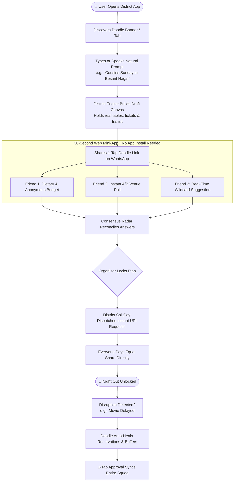
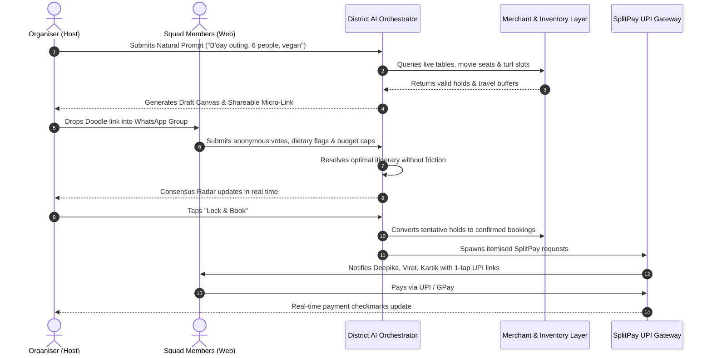

<div align="center">

# d👀dle by district
### *Stop the 80-text group chat debate. Turn "anything is fine" into a booked plan in 30 seconds.*

[](https://github.com/pavitrapoojary/district-by-zomato)
[](https://pavitrapoojary.github.io/district-by-zomato)
[](https://pavitra-poojary.vercel.app/)

<br/>

```text
       d  ( • ) ( • )  d  l  e
         ╰─────╯╰─────╯
      "The Eyes That See What Everyone Wants"
```

</div>

---

## 📌 Executive Summary

**doodle** is a social orchestration and group commerce layer built inside **District by Zomato**. It tackles the single biggest drop-off point in offline social plans: **the group indecision paradox**.

Whether it’s a birthday in T Nagar, Sunday beach cricket at Besant Nagar, or a Friday team outing along OMR:
1. One person tries to herd 6 friends across 80+ texts on WhatsApp.
2. Someone is vegan, someone is broke, someone won’t speak up.
3. One person gets stuck paying ₹6,000 upfront and chasing split payments for weeks.
4. If a movie showtime shifts by 30 minutes, the whole night unravels.

**Doodle turns vague group intent into a confirmed, paid, auto-healing itinerary with zero manual chasing.**

---

## ⚡ The Contrast: Before vs. After Doodle

```
┌────────────────────────────────────────────────────────┐
│  THE OLD WAY: 84 WhatsApp Texts & Chaos                │
├────────────────────────────────────────────────────────┤
│  Ranveer: "Where are we going Saturday?"               │
│  Deepika: "Anything is fine!"                          │
│  Kartik : "Not Italian again pls."                     │
│  Virat  : "Need vegan food though."                    │
│  Deepika: "What’s the budget?"                         │
│  *8 hours of silence*                                  │
│  Ranveer: "Are we doing this or not?"                  │
│  *Movie sells out. Table lost. Plan abandoned.*        │
└────────────────────────────────────────────────────────┘
                           ⬇️
┌────────────────────────────────────────────────────────┐
│  THE DOODLE WAY: 1 Tap · 30 Seconds · Zero Stress      │
├────────────────────────────────────────────────────────┤
│  1. Ranveer speaks intent: "B'day plan in T Nagar"     │
│  2. Doodle holds tables, tickets & travel buffers      │
│  3. Squad taps link: votes anonymously in 30 seconds   │
│  4. SplitPay collects via UPI directly to vendors      │
│  5. Timings change? Doodle auto-heals the schedule     │
└────────────────────────────────────────────────────────┘
```

---

## 🗺️ High-Level User Journey



---

## 🧠 System & Data Flow Architecture

The magic of Doodle lies in solving social frictions through technical decoupling: **headcounts are public, but votes and budgets remain strictly anonymous.**



---

## 💎 The 5 Signature Features of Doodle

### 1. 👀 Expressive "Doodle Eyes" Brand Identity
The two `o`s in Doodle are dynamic, expressive eyes that look around, blink, and track user actions. It represents the AI looking out for everyone's preferences (diet, budget, vibe) so no single friend is left out.

### 2. ⚡ Frictionless Web Mini-App
Friends receiving the WhatsApp link **do not need to install an app** or sign up. A lightweight mobile web experience verified by phone OTP allows them to answer in under 30 seconds.

### 3. 🛡️ The Anonymous Preference Shield
- **Budget Sliders**: Friends privately select their comfortable spend range. The AI targets the overlapping sweet spot without anyone feeling self-conscious.
- **Dietary Checks**: Automatically flags menus for vegan, Jain, gluten-free, or halal options before proposing dining spots.
- **Blind Voting**: Venue A/B polls show aggregate percentages only, eliminating peer pressure.

### 4. 💸 1-Tap SplitPay via UPI
No more "Hey man, could you send that ₹680 from last Saturday?"
- Pre-booked slots (movies, escape rooms, go-karting, bowling) are split immediately upon lock-in.
- On-table dining uses District’s merchant QR to divide food bills directly at the restaurant.

### 5. 🪄 The Auto-Healing Reshuffler
When real life happens (rain on an outdoor karting track, a film delay, or bad traffic), Doodle does not abandon the plan. It recalibrates time slots, shifts restaurant reservations within existing merchant holds, and alerts everyone with a clean updated timeline.

---

## 📊 Stakeholder Value Matrix

| Stakeholder | Pain Point Solved | Measurable Business Impact |
| :--- | :--- | :--- |
| **The Squad Organiser** | Eliminates awkward chasing, indecisive chats, and fronting large sums of money. | **10x faster plan completion** (from 6 hours of texting to 3 minutes). |
| **Squad Members** | Guarantees dietary compliance and spending limits without having to plead in the group. | **Zero friction participation**; higher turn-up rates. |
| **Merchants & Venues** | Last-minute group cancellations and empty tables due to disorganised crowds. | **Guaranteed advance bookings**, higher basket value, lower no-show rates. |
| **District by Zomato** | Bridges the gap between solo dining/ticketing and large multi-stop group commerce. | **Exponential viral loop (K-factor > 1)**: Every 1 host brings 5 new verified users to District. |

---

## 📈 Strategic KPIs & Metrics Targeted

```
┌─────────────────────────────────────────────────────────────┐
│  VIRAL COEFFICIENT (K-Factor)                               │
│  1 Active Host ──> 5 Squad Members Invited                  │
│  Expected K-Factor: 1.4 to 1.8 across urban nightlife       │
├─────────────────────────────────────────────────────────────┤
│  CONVERSION & RETENTION METRICS                             │
│  • Plan Completion Rate:   +42% vs. standard bookmarking    │
│  • Group Cart Size:        ₹2,400 avg per user / ₹14,400 GMV│
│  • SplitPay Collection:    94% settled within 60 minutes    │
│  • Unassisted Re-booking:  3.2x monthly plan frequency      │
└─────────────────────────────────────────────────────────────┘
```

---

## 📱 Prototype Walkthrough Steps

| Step | Screen / View | What Happens |
| :---: | :--- | :--- |
| **01** | **District App Home** | User browses Chennai feed, spots the spotlight **doodle** banner and bottom tab. |
| **02** | **Canvas Prompt** | Organiser speaks intent: *"Birthday outing from 2 pm at T Nagar till 11 pm, 6 of us, one vegan"*. |
| **03** | **Draft Timeline** | AI assembles live tickets (Nova Usman Rd), dinner (Kolam Kitchen), dessert with holds. |
| **04** | **WhatsApp Drop** | Rich interactive Doodle card is shared into the group chat. |
| **05** | **Squad Response** | Virat flags vegan diet, Deepika votes on dinner, Kartik suggests an activity. |
| **06** | **Consensus Radar** | Organiser watches votes consolidate automatically without reading 40 messages. |
| **07** | **1-Tap SplitPay** | Deepika taps "Pay with UPI" — host's screen updates to `Paid ✓` in real time. |
| **08** | **Auto-Heal Engine** | When a showtime shifts, Doodle adjusts table reservations with 1-tap host approval. |

---

## 🛠️ Tech Stack & Implementation Details

- **Core Interactive Prototype**: Single-file HTML5, CSS3, vanilla JavaScript.
- **Design System**: District by Zomato purple theme (`#6830F9`), Plus Jakarta Sans typography, iOS-style fluid mobile viewports.
- **Micro-Animations**: Keyframe glance-tracking eyes, CSS confetti bursts, and celebratory popups contained inside the mobile displays.
- **Accessibility**: ARIA switches, keyboard-navigable polls (`Enter` / `Space`), and system high-contrast awareness.

---

## 🔗 Quick Links & Resources

- 🌐 **Interactive Live Prototype**: [Open Doodle Prototype](https://pavitrapoojary.github.io/district-by-zomato)
- 💻 **GitHub Repository**: [github.com/pavitrapoojary/district-by-zomato](https://github.com/pavitrapoojary/district-by-zomato)
- 🎨 **Official District Logo Reference**: [View Asset](https://rukmini1.flixcart.com/image/1500/1500/xif0q/e-gift-voucher/v/w/e/open-anyone-district-by-zomato-100-original-imahhmcpztega5nu.jpeg?q=70)
- 👨‍💻 **Creator Portfolio**: [pavitra-poojary.vercel.app](https://pavitra-poojary.vercel.app/)

---

<div align="center">
  <b>Made with curiosity by <a href="https://pavitra-poojary.vercel.app/">Pavitra Poojary</a></b><br>
  <sub>Designed for District by Zomato · Making going out fun again</sub>
</div>